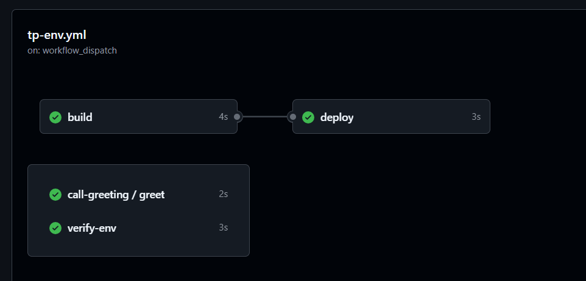

# TP 6 - Réponses

## Q1

La variable n'est pas disponible dans le step qui l'a définie car `GITHUB_ENV` est un
fichier que le runner ne lit qu'à la fin du step. Les variables qu'il contient sont
injectées dans l'environnement des steps suivants, mais le shell du step en cours a
déjà été lancé avec son environnement figé.

## Q2

Dans le job `verify-env`, `$APP_NAME` est vide. Chaque job s'exécute sur un runner
distinct (une machine virtuelle neuve), qui ne partage ni fichiers ni variables avec
les autres. La portée de `GITHUB_ENV` se limite donc aux steps suivants du même job.

## Q3

Avec `>`, le fichier `GITHUB_OUTPUT` est écrasé à chaque écriture : seul le dernier
output écrit subsiste et le premier est perdu (valeur vide à la lecture). Il faut
utiliser `>>`, qui ajoute une ligne à la fin du fichier.

## Q4

`GITHUB_ENV` est un fichier local au runner du job : sa portée se limite aux steps
suivants du même job. Chaque job s'exécute sur un runner distinct, donc `deploy` ne
voit pas les variables de `build`. `GITHUB_OUTPUT`, associé à `outputs:` au niveau du
job et à `needs`, transmet la valeur via GitHub aux jobs dépendants.

## Q5

Sans `needs: build`, `deploy` s'exécute en parallèle de `build` (sans attendre sa fin,
même s'il échoue) et n'a plus accès à ses outputs : `needs.build.outputs.full_version`
est vide, sans erreur.

## Capture d'écran de l'exécution

Exécution réussie du workflow `tp-env.yml` : les jobs `build` et `deploy` (ainsi que `call-greeting` et `verify-env`) sont verts.

